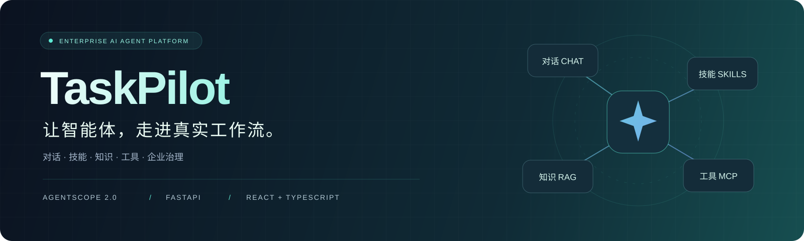
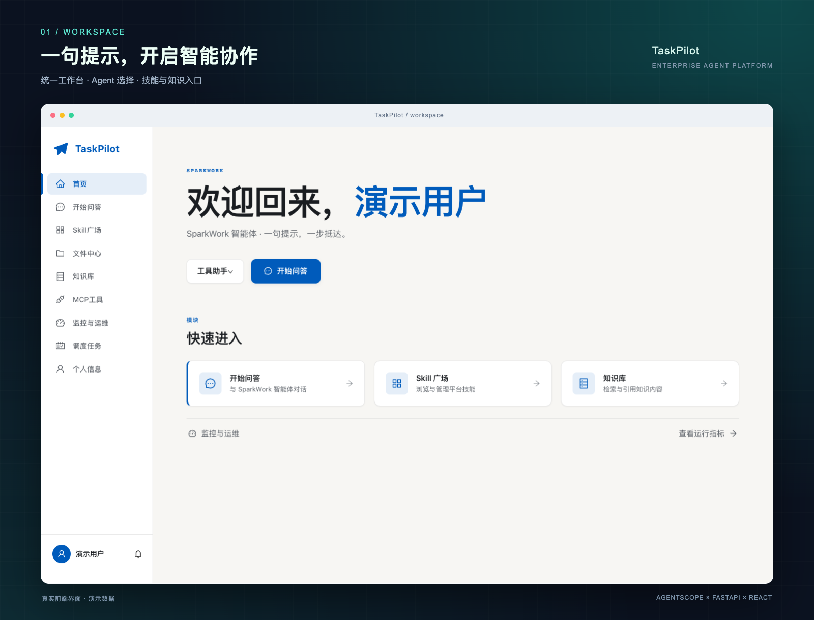
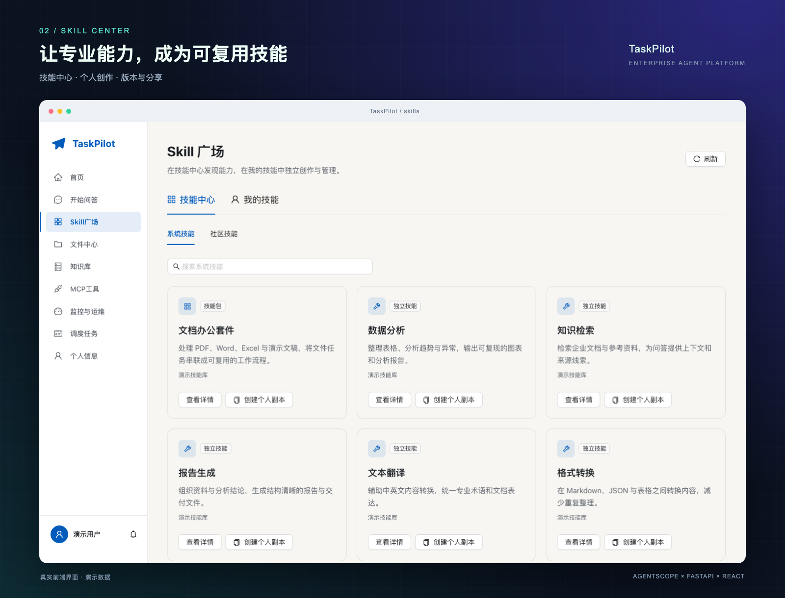
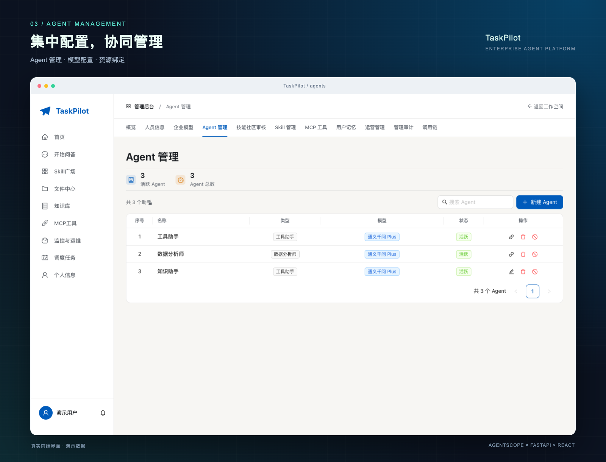
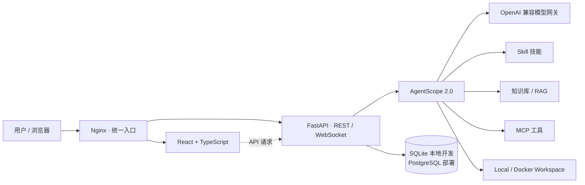

<p align="center">
  
</p>

<h1 align="center">TaskPilot · 企业级 AI Agent 平台</h1>

<p align="center">
  <strong>从一句提示，到一份交付。</strong><br />
  将智能对话、专业技能、企业知识与外部工具，连接成可管理的工作流。
</p>

<p align="center">
  <code>AgentScope 2.0</code> &nbsp; <code>FastAPI</code> &nbsp; <code>React 18</code> &nbsp; <code>TypeScript</code> &nbsp; <code>MCP</code>
</p>

<p align="center">
  <a href="#界面预览">界面预览</a> ·
  <a href="#核心能力">核心能力</a> ·
  <a href="#快速开始">快速开始</a> ·
  <a href="#系统架构">系统架构</a> ·
  <a href="#开发与验证">开发与验证</a> ·
  <a href="#文档导航">文档导航</a>
</p>

---

## 界面预览

以下展示图使用**当前前端与演示数据**渲染，并加入统一的渐变背景、浏览器边框与功能标题。账号、技能和 Agent 配置均为示例，不代表默认安装内容。

### 01 · 智能工作台

选择 Agent，进入对话，快速访问技能广场与知识库，让日常工作从一个入口开始。



### 02 · 技能中心

在系统与社区中发现能力，在个人空间中创建、导入、编辑和分享技能，让专业流程可以复用。



### 03 · Agent 管理

集中管理智能体、模型与资源绑定，从工作空间进入管理后台，按职责配置不同助手。



<details>
<summary>🖼️ 如何更新 README 展示图</summary>

图片与生成脚本都保存在 [`docs/assets/`](docs/assets/)。先构建前端，再运行截图脚本：

```bash
npm run build --prefix frontend
npm install --prefix test
npx --prefix test playwright install chromium
node docs/assets/generate-showcase.mjs
```

也可以通过 `CHROME_EXECUTABLE` 指定已安装的 Chrome，或通过 `PLAYWRIGHT_MODULE` 指定 Playwright 模块的绝对路径。脚本使用临时本地静态服务，所有 API 请求均由演示数据替代，无需启动后端或填写真实账号。

</details>

## 核心能力

| 能力 | 你可以做什么 |
| :--- | :--- |
| 💬 **智能对话** | 与 Agent 多轮交流，查看 WebSocket 流式输出，上传附件并管理会话历史。 |
| 🤖 **Agent 工作流** | 使用工具助手与数据分析师两类基础架构，为自定义 Agent 配置提示词、模型及资源绑定。 |
| 🧩 **技能生态** | 浏览系统与社区技能，创建或导入个人技能，管理草稿、测试、发布、分享与版本。 |
| 📚 **企业知识** | 管理个人与共享知识库，解析和索引文档，结合语义检索与知识图谱辅助问答。 |
| 🔌 **MCP 工具** | 连接本地或远程 MCP 服务，查看工具定义，为 Agent 绑定外部能力。 |
| 📁 **文件交付** | 集中管理上传文件和 Agent 产物，支持预览、下载、回收站与磁盘对账。 |
| ⏱️ **任务调度** | 创建定时、一次性或手动任务，查看执行历史与任务通知。 |
| 📊 **监控与治理** | 查看会话与 Token 使用情况，管理人员、模型授权、记忆、审计与调用链。 |

> 技能中心需启用 `SKILL_HUB_ENABLED`；资源版本、工具策略、记忆候选审核与运营治理等能力按对应配置开关启用。具体说明见[文档导航](#文档导航)。

## 快速开始

本地开发使用 **Python 3.11、Node.js 20+、SQLite**。前后端分别运行在 `8000` 和 `5173` 端口。

### 1. 准备后端环境

在项目根目录执行；已有 `agentscope` 环境时可直接激活。

```bash
conda create -n agentscope python=3.11 -y
conda activate agentscope
cd backend
pip install -r requirements.txt
```

在 `backend/.env` 中填写本地配置。当前代码使用 `AI_GATEWAY_*` 配置项，模型服务需提供 OpenAI 兼容接口：

```dotenv
APP_ENV=development
DATABASE_URL=sqlite:///./app.db
CORS_ORIGINS=http://localhost:5173,http://127.0.0.1:5173

AI_GATEWAY_BASE_URL=https://dashscope.aliyuncs.com/compatible-mode/v1
AI_GATEWAY_API_KEY=replace-with-your-api-key
MODEL_NAME=qwen-plus

JWT_SECRET_KEY=replace-with-a-random-secret
SECRET_ENCRYPTION_KEY=replace-with-another-random-secret

SKILL_HUB_ENABLED=true
WORKSPACE_BACKEND=local
```

`AI_GATEWAY_API_KEY` 填入所选模型服务的密钥；`.env` 与数据库文件不要提交到仓库。完整生产配置可参考 [`backend/.env.prod.example`](backend/.env.prod.example)。

### 2. 初始化并启动 API

继续在 `backend/` 中执行：

```bash
python init_db.py
python -m uvicorn app.main:app --reload --port 8000
```

初始化脚本创建管理员、工具助手和数据分析师等基础数据。API 文档：[http://localhost:8000/docs](http://localhost:8000/docs)。

### 3. 启动前端

打开另一个终端，从项目根目录执行：

```bash
cd frontend
npm install
npm run dev
```

打开 [http://localhost:5173](http://localhost:5173)。Vite 已配置 API 与 WebSocket 代理，指向本机 `8000` 端口。

### 4. 登录并开始协作

| 项目 | 初始值 |
| :--- | :--- |
| 管理员账号 | `admin` |
| 初始密码 | `Initial@123456` |
| 首次登录 | 必须修改密码 |

进入工作台选择 Agent，然后开始问答。管理员可在后台配置模型授权、技能、知识库与 MCP 绑定，按实际业务组装助手。

## 系统架构



本地开发由 Vite 代理后端接口；容器部署提供 Nginx、PostgreSQL、Redis 与 Docker Workspace 配置。入口配置见 [`docker-compose.yml`](docker-compose.yml) 和 [`nginx/nginx.conf`](nginx/nginx.conf)。

### 技术栈

| 层次 | 主要技术 |
| :--- | :--- |
| Agent 引擎 | AgentScope **2.0.5**、Skill、MCP、Workspace |
| API 服务 | FastAPI **0.139.2**、Pydantic **2.13.4**、Uvicorn |
| 数据与认证 | SQLAlchemy **2.0.36**、SQLite / PostgreSQL、JWT、bcrypt |
| 前端界面 | React **18**、TypeScript、Ant Design **5**、Zustand、Vite **6** |
| 可视化 | ECharts、G6、vis-network |
| 部署与调度 | Docker Compose、Nginx、Redis、APScheduler |

后端锁定版本见 [`backend/requirements.txt`](backend/requirements.txt)，前端依赖范围见 [`frontend/package.json`](frontend/package.json)。

### 项目结构

```text
.
├── backend/
│   ├── app/
│   │   ├── api/v1/        # HTTP 与 WebSocket 接口
│   │   ├── agents/        # AgentScope、技能与工作空间
│   │   ├── core/          # 安全、认证与权限
│   │   ├── models/        # 数据模型
│   │   ├── schemas/       # 请求与响应验证
│   │   ├── services/      # 业务服务
│   │   └── main.py        # FastAPI 入口
│   ├── init_db.py         # 初始化数据库与管理员
│   └── migrate_*.py       # 数据迁移脚本
├── frontend/
│   └── src/
│       ├── api/           # API 客户端
│       ├── components/    # 共享组件
│       ├── pages/         # 按功能组织的页面
│       └── store/         # Zustand 状态
├── docs/                  # 功能文档与 README 展示图
├── test/                  # 验证与诊断脚本
├── nginx/                 # 反向代理配置
├── deploy/                # 部署工具
└── docker-compose.yml     # 容器服务编排
```

`backend/knowledge/`、`uploads/`、`outputs/`、`traces/` 等目录保存运行数据，不属于应手工编辑的源码。

## 开发与验证

前端类型检查与生产构建：

```bash
cd frontend
npm run build
```

浏览器验证脚本集中在 [`test/`](test/)。例如，管理后台回归脚本使用构建产物与本地演示接口：

```bash
# 在项目根目录执行，先完成前端构建
npm install --prefix test
npx --prefix test playwright install chromium
node test/_test_admin_redesign52.mjs
```

其他脚本可能需要运行中的前后端、专用测试环境或临时测试账号，运行前请查看对应脚本说明。升级已有数据库时，先备份，再按相关模块文档执行迁移。

## 常见问题

<details>
<summary><strong>模型无法调用，应该检查哪里？</strong></summary>

检查 `backend/.env` 中的 `AI_GATEWAY_BASE_URL`、`AI_GATEWAY_API_KEY` 和 `MODEL_NAME`，确认网关可达、模型 ID 有效，并在后台核对该用户的模型授权。修改环境变量后重启后端。

</details>

<details>
<summary><strong>如何创建新的 Agent？</strong></summary>

进入「管理后台 → Agent 管理」，创建助手并配置提示词、模型、知识库与 MCP 资源。工具助手和数据分析师是预置基础 Agent，具体可编辑项由页面与权限控制。

</details>

<details>
<summary><strong>技能中心不可用或列表为空？</strong></summary>

确认已启用 `SKILL_HUB_ENABLED=true` 并重启后端，再检查技能是否已导入、发布及授权。README 展示的技能卡片使用演示数据，不会自动写入本地数据库。

</details>

<details>
<summary><strong>WebSocket 无法连接？</strong></summary>

确认后端运行在 `8000` 端口，前端使用 Vite 配置的 `5173` 端口。代理规则见 [`frontend/vite.config.ts`](frontend/vite.config.ts)；生产环境还需检查 Nginx 的 WebSocket 转发配置。跨域直接访问时，核对 `CORS_ORIGINS`。

</details>

## 文档导航

| 文档 | 内容 |
| :--- | :--- |
| [技能中心与个人技能](docs/skill-hub52.md) | 技能导入、版本、分享、社区审核与运行边界 |
| [技能广场管理](docs/skill-square-administration.md) | 系统技能与技能包管理 |
| [技能演化](backend/docs/SKILL_EVOLUTION.md) | 技能演化工作流与配置 |
| [企业模型网关](docs/model-gateway.md) | 模型目录、授权规则与迁移 |
| [MCP 治理](docs/mcp-governance.md) | 工具接入、策略与权限 |
| [管理后台](backend/README_ADMIN_STAGE1.md) | 管理功能与迁移说明 |
| [Nginx 部署](nginx/DEPLOY_PROXY.md) | 裸机部署与反向代理 |

---

<p align="center">
  <strong>TaskPilot</strong><br />
  <sub>让智能体，走进真实工作流。</sub>
</p>
